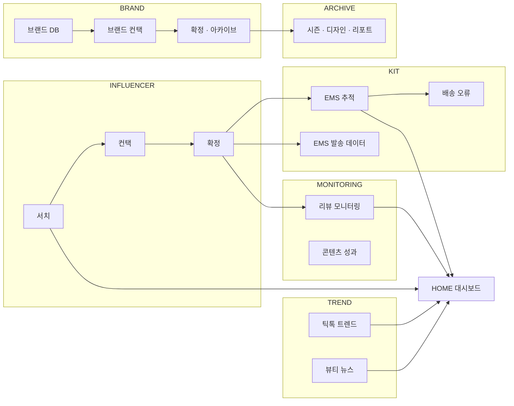
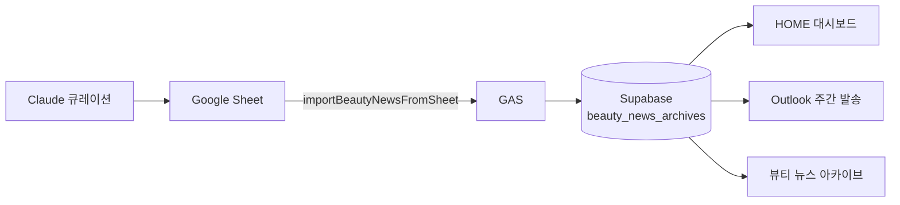
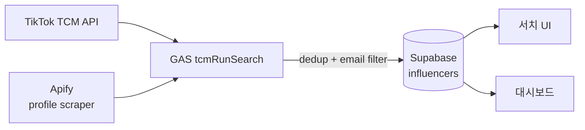
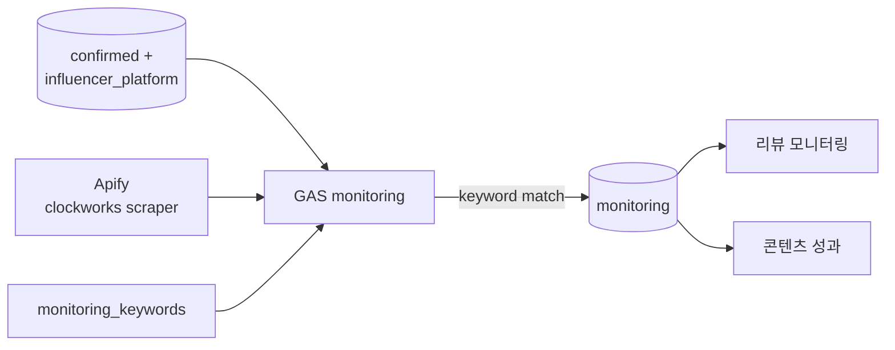

# MiMuse — Skill Pipelines

Each skill follows the same 3-stage pattern as the reference automation:

```
[ ① 데이터 수집 ]  →  [ ② 가공 · 분석 ]  →  [ ③ 전달 ]
```

| Stage | Role |
|-------|------|
| **① 수집** | External API, scraper, form, or manual input |
| **② 가공** | Filter, dedup, match, transform → **Supabase** |
| **③ 전달** | Dashboard, email, export, archive UI |

**Shared infrastructure:** React app · Supabase (DB + Storage) · Google Apps Script API

---

## Overview map



---

# TREND

## 1. 뷰티 뉴스 브리핑 (`/trend/beauty-news`)

```
┌─────────────────────┐     ┌──────────────────────────┐     ┌─────────────────────┐
│  ① 데이터 수집        │ ──► │  ② 가공 · 분석            │ ──► │  ③ 전달              │
│  Claude + 수동 큐레이션 │     │  GAS + Supabase           │  │  대시보드 / 이메일     │
│  Google Sheet        │     │  importBeautyNewsFromSheet│   │  아카이브 페이지       │
└─────────────────────┘     └──────────────────────────┘     └─────────────────────┘
```

| Stage | Tool | What happens |
|-------|------|--------------|
| ① 수집 | **Claude** (manual workflow) | Weekly US beauty news → JSON in Google Sheet |
| ① 수집 | **Google Sheets** | Columns: `report_title`, `windows_start/end`, `categories`, `keywords` |
| ② 가공 | **GAS** `importBeautyNewsFromSheet` | Parse sheet → upsert `beauty_news_archives` (latest row) |
| ② 가공 | **Supabase** | Store categories, articles, keyword explanations |
| ③ 전달 | **Dashboard** (`/`) | 이번 주 브리핑 카드 + 키워드 요약 |
| ③ 전달 | **Outlook** `sendWeeklyBeautyNewsEmail` | Mon 09:00 KST trigger → `email_recipients` (selected=true) |
| ③ 전달 | **Archive** (`/trend/beauty-news-archive`) | Past briefings by slug |

**수집 데이터:** 뉴스 제목 · 링크 · 출처 · 요약 · 카테고리별 건수 · 키워드 설명  
**리포트 내용:** 주간 Top 트렌드 요약 · 카테고리별 기사 · US 뷰티 키워드 인사이트



---

## 2. 틱톡 트렌드 분석 (`/trend/tiktok`)

```
┌─────────────────────┐     ┌──────────────────────────┐     ┌─────────────────────┐
│  ① 데이터 수집        │ ──► │  ② 가공 · 분석            │ ──► │  ③ 전달              │
│  Microsoft Outlook   │     │  GAS 필터 + React UI      │     │  트렌드 페이지         │
│  Drafts 폴더         │     │  해시태그 · 본문 정리       │     │  이메일 발송 (선택)    │
└─────────────────────┘     └──────────────────────────┘     └─────────────────────┘
```

| Stage | Tool | What happens |
|-------|------|--------------|
| ① 수집 | **Microsoft Graph** | `getAllTrendDrafts` — read Outlook drafts |
| ① 수집 | Filter | Subject contains: trend, 트렌드, beauty, 뷰티 |
| ② 가공 | **GAS** + **React** | Strip HTML, sort by date, hashtag preview |
| ③ 전달 | **UI** `/trend/tiktok` | Draft list + send via `sendBeautyNewsEmail` |
| ③ 전달 | **Dashboard** | TikTok hashtag preview snippet |

**수집 데이터:** Outlook 초안 제목 · 본문 · 수정일  
**리포트 내용:** 트렌드/뷰티 관련 초안 목록 · 이메일 공유

---

# INFLUENCER

## 3. 인플루언서 서치 / 리스트업 (`/influencer/search`)

```
┌─────────────────────┐     ┌──────────────────────────┐     ┌─────────────────────┐
│  ① 데이터 수집        │ ──► │  ② 가공 · 분석            │ ──► │  ③ 전달              │
│  TikTok TCM API      │     │  GAS tcmRunSearch         │     │  서치 UI 결과 테이블   │
│  Apify Profile Scraper│     │  dedup · 이메일 · 티어     │     │  Supabase 저장        │
└─────────────────────┘     └──────────────────────────┘     └─────────────────────┘
```

| Stage | Tool | What happens |
|-------|------|--------------|
| ① 수집 | **TikTok TCM API** | `creator/discover` by keyword + follower range |
| ① 수집 | **Apify** `automation-lab~tiktok-profile-scraper` | Profile bio, email regex, avatar, stats (max 200/run, 4GB; actor timeout ~250+) |
| ② 가공 | **GAS** | Pre-filter: dedup, follow ratio → Apify queue → email required |
| ② 가공 | **Supabase** | `influencers` + `tiers` by phase |
| ③ 전달 | **UI** | Tier table, search results, save to DB |
| ③ 전달 | **Dashboard** | 서치 완료 N/1000 · 티어별 · 컨택 예정 |

**Apify actor:** `automation-lab~tiktok-profile-scraper`  
**GAS actions:** `tcmRunSearch`, `checkRunStatus`, `getRunResults`, `loadCreatorResults`

**수집 데이터:** 핸들 · 표시명 · 이메일 · 팔로워 · 프로필 URL · 아바타 · 티어  
**리포트 내용:** 티어별 후보 수 · 필터 제외 통계 (이메일 없음 / 중복)



---

## 4. 인플루언서 컨택 (`/influencer/contact`)

```
┌──────────────┐   ┌────────────────────┐   ┌──────────────────┐   ┌─────────────────┐
│ ① Supabase   │ → │ ② 템플릿 관리 페이지  │ → │ ③ Outlook + GAS  │ → │ ④ 컨택 페이지    │
│ contacted    │   │ create template    │   │ sendOutreachEmail│   │ 상태 업데이트    │
│ email_templates│  │ email_templates 저장│   │ 회신 · 바운스 동기화│   │ outreach_messages│
└──────────────┘   └────────────────────┘   └──────────────────┘   └─────────────────┘
```

| Stage | Tool | What happens |
|-------|------|--------------|
| ① 수집 | **Supabase** | `contacted=true` influencers, existing `email_templates` |
| ② 템플릿 | **템플릿 관리** (`/influencer/template`) | Create/edit template title, body, signature → save to `email_templates` |
| ③ 발송 | **Outlook** `sendOutreachEmail` | HTML email + signature logo (Supabase `email-assets`) |
| ③ 동기화 | **Outlook** `syncOutlookReplies` / `syncOutlookDeliveryFailures` | Match replies & bounces → update `status` |
| ③ 로그 | **Supabase** | `outreach_messages` log per send |
| ④ 전달 | **컨택 UI** (`/influencer/contact`) | Bulk send, status badges, filters |
| ④ 전달 | **Dashboard** | 발송 성과율 · 회신 수 |

**수집 데이터:** 이메일 · 템플릿 · 기존 컨택 이력  
**리포트 내용:** 발송/회신/협상 상태 · 바운스 알림

---

## 5. 확정 인플루언서 데이터 (`/influencer/confirmed`)

```
┌─────────────────────┐     ┌──────────────────────────┐     ┌─────────────────────┐
│  ① 데이터 수집        │ ──► │  ② 가공 · 분석            │ ──► │  ③ 전달              │
│  Google Form 응답     │     │  seq 부여 · 필드 매핑       │     │  확정 목록 UI         │
│  수동 확정 (서치→컨택) │     │  influencers JOIN         │     │  EMS / 모니터링 입력  │
└─────────────────────┘     └──────────────────────────┘     └─────────────────────┘
```

| Stage | Tool | What happens |
|-------|------|--------------|
| ① 수집 | **Google Form** → Supabase | Address, phone, content platforms, review link |
| ① 수집 | **Manual** | Accept from contact flow → `confirmed_influencers` |
| ② 가공 | **Supabase** | `seq` 1–N, join `influencers` for handle/email |
| ③ 전달 | **UI** | Confirmed table, edit notes, form status |
| ③ 전달 | **Downstream** | Feeds EMS data, monitoring handles, archive |

**수집 데이터:** 주소 · 전화 · SNS · 리뷰 링크 · 메모  
**리포트 내용:** 확정 50명/phase · 폼 제출 여부

---

# MONITORING

## 6. 리뷰 모니터링 (`/influencer/monitoring`)

```
┌─────────────────────┐     ┌──────────────────────────┐     ┌─────────────────────┐
│  ① 데이터 수집        │ ──► │  ② 가공 · 분석            │ ──► │  ③ 전달              │
│  Apify TikTok Scraper│     │  키워드 매칭 · 브랜드 태깅   │     │  모니터링 테이블       │
│  (최대 50명 × 50영상)  │     │  views/likes/comments     │     │  대시보드 · 성과 리포트 │
└─────────────────────┘     └──────────────────────────┘     └─────────────────────┘
```

| Stage | Tool | What happens |
|-------|------|--------------|
| ① 수집 | **Supabase** | TikTok handles from `influencer_platform` (max 50) |
| ① 수집 | **Apify** `clockworks~tiktok-profile-scraper` | 최근 7일 (실행일 ~ 7일 전, 버튼 클릭 시 자동 계산) |
| ② 가공 | **GAS** | Match caption vs `monitoring_keywords` (brand + mimuse) |
| ② 가공 | **Supabase** | Upsert `monitoring` rows (review_link, views, likes, keywords) |
| ③ 전달 | **UI** `/influencer/monitoring` | Live table, keyword editor, manual run trigger |
| ③ 전달 | **UI** `/influencer/monitoring-report` | Content performance aggregates |
| ③ 전달 | **Dashboard** | 브랜드별 리뷰 수 (mimuse 제외) |

**Apify actor:** `clockworks~tiktok-profile-scraper`  
**GAS actions:** `runMonitoringScrape`, `checkMonitoringRun`, `processApifyRunById`

**수집 데이터:** 영상 URL · 조회수 · 좋아요 · 댓글 · 게시일 · 캡션  
**리포트 내용:** 키워드 히트 영상 · 브랜드별 리뷰 수 · 플랫폼별 성과



---

# KIT (EMS)

## 7. EMS 배송 추적 (`/kit/ems`)

```
┌─────────────────────┐     ┌──────────────────────────┐     ┌─────────────────────┐
│  ① 데이터 수집        │ ──► │  ② 가공 · 분석            │ ──► │  ③ 전달              │
│  수동 접수/등기 입력   │     │  17track API 동기화        │     │  EMS 테이블 UI        │
│  17track API         │     │  상태 매핑 · 재발송 플래그   │     │  우체국/17track 링크  │
└─────────────────────┘     └──────────────────────────┘     └─────────────────────┘
```

| Stage | Tool | What happens |
|-------|------|--------------|
| ① 수집 | **Manual UI** | Application number, EMS number, registered date |
| ① 수집 | **17track API v2.4** | `register17Track`, `syncAllEmsTracking` |
| ② 가공 | **GAS** | Map status → Korean labels, update `ems_tracking` |
| ② 가공 | **Supabase** | Join `confirmed_influencers` for name/address |
| ③ 전달 | **UI** | Status dropdown, detail modal, 17track/epost links |
| ③ 전달 | **Dashboard** | 배송 중 / 완료 / 오류 stats |

**GAS actions:** `syncAllEmsTracking`, `syncOneEmsTracking`, `get17TrackInfo`

**수집 데이터:** 접수번호 · 등기번호 · 배송 상태 · 이벤트 타임라인  
**리포트 내용:** 배송 중 N건 · 완료 N건 · 예외/오류 N건

---

## 8. EMS 발송 데이터 (`/kit/ems-data`)

```
┌─────────────────────┐     ┌──────────────────────────┐     ┌─────────────────────┐
│  ① 데이터 수집        │ ──► │  ② 가공 · 분석            │ ──► │  ③ 전달              │
│  confirmed_influencers│    │  주소 정규화 · 전화 분리     │     │  EMS 데이터 테이블    │
│  Google Form 주소     │     │  우체국 양식 컬럼 매핑       │     │  Excel 다운로드       │
└─────────────────────┘     └──────────────────────────┘     └─────────────────────┘
```

| Stage | Tool | What happens |
|-------|------|--------------|
| ① 수집 | **Supabase** | Address fields from confirmed influencers |
| ② 가공 | **React** | Phone split (cc/area/number), address validation, edit modal |
| ③ 전달 | **UI** | Paginated table per phase |
| ③ 전달 | **XLSX export** | Korea Post submission format download |

**수집 데이터:** 수취인 · 국가 · 우편번호 · 주소 · 이메일 · 전화  
**리포트 내용:** 발송 대상 50명/phase · Excel export for postal office

---

## 9. EMS 배송 오류 / 재발송 (`/kit/ems/errors`)

```
┌─────────────────────┐     ┌──────────────────────────┐     ┌─────────────────────┐
│  ① 데이터 수집        │ ──► │  ② 가공 · 분석            │ ──► │  ③ 전달              │
│  Outlook 배송 실패 동기화│    │  ems_reshipments 등록     │     │  오류 목록 UI         │
│  수동 재발송 체크      │     │  재발송 이메일 템플릿       │     │  일괄 재발송 메일      │
└─────────────────────┘     └──────────────────────────┘     └─────────────────────┘
```

| Stage | Tool | What happens |
|-------|------|--------------|
| ① 수집 | **Outlook** `syncOutlookDeliveryFailures` | Failed delivery notifications |
| ① 수집 | **Manual** | Checkbox on EMS row → `ems_reshipments` |
| ② 가공 | **Supabase** | Link reship to `confirmed_influencer_id` |
| ③ 전달 | **UI** | Error list + bulk send progress modal |
| ③ 전달 | **Outlook** | Reship notification emails |

---

# BRAND

## 10. 브랜드 DB (`/brand/db`)

```
┌─────────────────────┐     ┌──────────────────────────┐     ┌─────────────────────┐
│  ① 데이터 수집        │ ──► │  ② 가공 · 분석            │ ──► │  ③ 전달              │
│  Excel import         │     │  dedup · phase import     │     │  일반 / 개인 DB UI    │
│  수동 입력 · 이전 phase│     │  brand_general / personal │     │  브랜드 컨택 풀        │
└─────────────────────┘     └──────────────────────────┘     └─────────────────────┘
```

**수집 데이터:** 브랜드명 · 이메일 · 회사 · 제품 카테고리 · 담당자  
**리포트 내용:** 검색 풀 ~1000 · contacted 상태

---

## 11. 브랜드 컨택 (`/brand/contact`)

Same pipeline pattern as **인플루언서 컨택** — Outlook send + reply sync + `brand_contacts` / outreach log.

---

## 12. 확정 브랜드 + 자료 아카이브 (`/brand/confirmed`)

```
┌─────────────────────┐     ┌──────────────────────────┐     ┌─────────────────────┐
│  ① 데이터 수집        │ ──► │  ② 가공 · 분석            │ ──► │  ③ 전달              │
│  파일 업로드 (이미지/PDF)│   │  storage_path · category  │     │  아카이브 뷰어        │
│  브랜드 메타 수동 입력  │     │  Supabase Storage          │     │  ZIP 다운로드         │
└─────────────────────┘     └──────────────────────────┘     └─────────────────────┘
```

| Storage | `brand-archive` bucket — logo, product, cutout, ingredients |
| DB | `confirmed_brands`, `confirmed_brand_assets`, `archive_memo` |

**수집 데이터:** 로고 · 제품컷 · 전성분표 · 비고 메모  
**리포트 내용:** 브랜드별 자료 완료율 · 시즌 아카이브 / 브랜드 리포트 연동

---

# ARCHIVE

## 13. 아카이브 (`/archive`)

| Sub-skill | ① 수집 | ② 가공 | ③ 전달 |
|-----------|--------|--------|--------|
| **디자인 아카이브** | Phase 이미지 upload | `phases.design_*` paths | Design phase page |
| **시즌 컬렉션** | Brand cover images | `product_cover` assets | Season grid |
| **브랜드별 리포트** | Archive assets + copy | `season-collection-content` | Per-brand report page |

Data source: Supabase + Storage (no external API).

---

# HOME 대시보드 (`/`)

```
┌──────────────────────────────────────────────────────────────────┐
│  ② 집계 (Supabase queries only — no external collection)          │
│  listup · outreach · EMS · monitoring · beauty news keywords      │
└──────────────────────────────────────────────────────────────────┘
                              ▼
                    HOME feature cards + D-day
```

**전달 내용:** 서치 완료 N/1000 · 발송 성과율 · EMS 상태 · 모니터링 리뷰 수 · 이번 주 브리핑

---

# External systems by skill

| Skill | Apify | TikTok TCM | Outlook | 17track | Google Sheet | Supabase |
|-------|-------|------------|---------|---------|--------------|----------|
| 뷰티 뉴스 | — | — | ✅ send | — | ✅ import | ✅ |
| 틱톡 트렌드 | — | — | ✅ drafts | — | — | — |
| 인플루언서 서치 | ✅ | ✅ | — | — | — | ✅ |
| 인플루언서 컨택 | — | — | ✅ | — | — | ✅ |
| 확정 인플루언서 | — | — | — | — | Form→DB | ✅ |
| 리뷰 모니터링 | ✅ | — | — | — | — | ✅ |
| EMS 추적 | — | — | — | ✅ | — | ✅ |
| EMS 발송 데이터 | — | — | — | — | — | ✅ |
| 브랜드 DB | — | — | — | — | Excel | ✅ |
| 브랜드 아카이브 | — | — | — | — | — | ✅ Storage |

---

# Future: automated report pipeline (planned)

For dashboard PDF/PPT export (your planned feature):

```
[ Supabase stats + archive images ]  →  [ Client-side PDF/PPT generator ]  →  [ Download / optional save ]
```

No new Apify actor needed — reads existing DB + Storage only.

---

*Generated from MiMuse codebase. Update when GAS routes or actors change.*

---

## Presentation (`MiMuse-Dashboard-Workflow.pptx`)

Regenerate after pipeline changes:

```bash
python docs/pipelines/generate_ppt.py
```

**Slides:** 표지 · 전체 아키텍처 · 파이프라인 5종 · 업무별 툴 · **비용 (월)** · **Apify 예상 비용 계산**  
**Theme:** MiMuse web colors (`--blue-dk`, `--blue`, `--yellow-md`, `--surface`)  
**Font:** 나눔휴먼OTF — install on PC for correct rendering in PowerPoint
